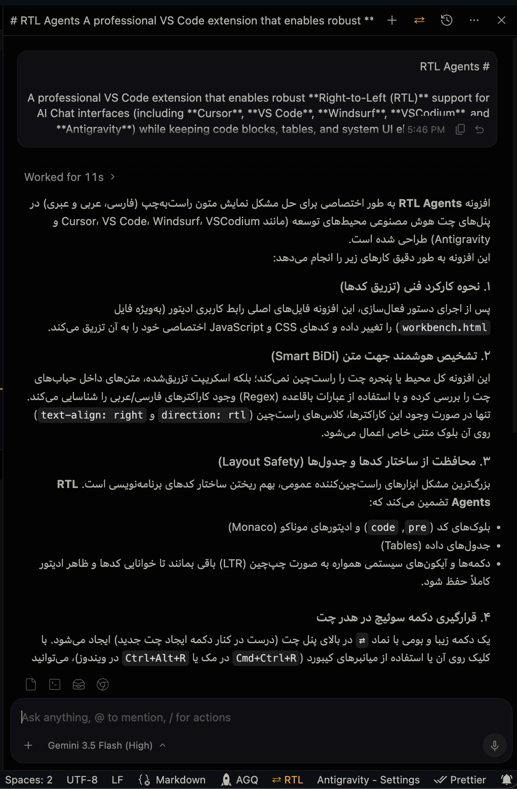

<div align="center">
  
  <h1>RTL Agents</h1>
  <p><strong>Right-to-Left Support for AI Chat Panels in Your Editor</strong></p>

  <p>
    <a href="https://github.com/Foshati/rtl-agents/blob/main/package.json"></a>
    <a href="https://code.visualstudio.com"></a>
    <a href="https://github.com/Foshati/rtl-agents/blob/main/LICENSE"></a>
  </p>
</div>

---

## 🚀 Overview

**`RTL Agents`** brings proper **Right-to-Left** rendering to the AI chat panels of **Antigravity**, **Cursor**, **VS Code**, **Windsurf**, and **VSCodium** — without flipping your editor, your code, or your tables.

Message text is pinned to a right-to-left base, and the browser lays out the Latin runs inside it — library names, commands, inline code — in their own left-to-right order. Because it is pure CSS applied at layout time, streamed text never renders left-aligned and then jumps.

Optimized for **Persian**, **Arabic**, and **Hebrew**.

<div align="center">
  
  <p><em>Persian AI responses aligned right, with code blocks and UI left intact</em></p>
</div>

---

## ✨ Features

- 🌐 **Multi-IDE Support**: Detects the running editor and patches every workbench document it owns — including Antigravity's separate agent window.
- ⚡ **Smart Per-Message Direction**: Each message takes its direction from the share of right-to-left letters in it, ignoring code — a Persian reply is RTL, an English one LTR, and each table is judged on its own. A Persian sentence that opens with `API` or `npm install` stays RTL.
- ✨ **No Flicker While Streaming**: Direction is decided inside the MutationObserver callback that sees the text arrive — delivered before the frame is painted — and leans on the conversation, so a streamed reply does not render one way and then jump. The observer only stamps an attribute on the message root; it never touches the host's text.
- 🛡️ **Code & Layout Safety**: `pre`, `code`, Monaco editors, and table column order stay LTR — including a code snippet sitting inside a Persian sentence.
- ⇄ **Native Toggle Button**: Injects a `⇄` button into the chat header next to "New Chat", borrowing its styling. The header button and the status bar item always agree.
- 💾 **Persistent & Synced**: Remembers your preference across reloads and keeps every patched window in step instantly.
- 🪟 **Reaches Antigravity IDE's Chat Frame**: Antigravity IDE renders its agent chat in a separate frame served from its local agent, out of reach of workbench files. RTL Agents adds one failure-safe line to `out/main.js` that runs the same CSS and JS inside that frame, and removes it again on deactivation.
- 🔑 **Checksum Bypass**: Strips the relevant `product.json` checksums to avoid the `[Unsupported]` warning, and restores them exactly on deactivation.
- ♻️ **Clean Uninstall**: Deactivating removes the button immediately and restores every file byte for byte. A backup from an older IDE build is never written over a newer one.
- 🔄 **Auto-Reactivation**: Detects editor updates and re-applies the patch.

---

## 📦 Installation

Install from the [VS Code Marketplace](https://marketplace.visualstudio.com/items?itemName=foshati.rtl-agents) or [Open VSX](https://open-vsx.org/extension/foshati/rtl-agents), or grab the `.vsix` from [Releases](https://github.com/Foshati/rtl-agents/releases/latest):

```bash
# VS Code
code --install-extension rtl-agents-<version>.vsix --force

# Cursor
cursor --install-extension rtl-agents-<version>.vsix --force

# Antigravity
antigravity --install-extension rtl-agents-<version>.vsix --force
```

### Activate

Because the extension modifies workbench files on disk to reach the chat panel, it needs a one-time activation.

1. Open the Command Palette — `Ctrl+Shift+P` (Windows/Linux) or `Cmd+Shift+P` (macOS).
2. Run **`RTL Agents: Activate RTL`**.
3. **Fully quit and reopen** your IDE. A "Reload Window" is not enough.
4. Open the AI chat and press `Ctrl+Alt+R` / `Cmd+Ctrl+R`, or click the `⇄` button.

> [!TIP]
> **Permission denied on macOS or Linux?**
> Editor files on disk are write-protected, so this is expected. The command outputs a copyable `sudo chown ...` fix — run it in your terminal, then activate again.

---

## ⚙️ Configuration

```json
{
  "rtl-agents.baseDirection": "smart",
  "rtl-agents.customSelectors": [".my-custom-chat-panel"]
}
```

- `rtl-agents.baseDirection`
  - `"smart"` (default) — each message gets its own direction from the share of right-to-left letters in it, ignoring code. A Persian reply is RTL, an English one LTR, and each table is judged on its own. The decision is made before the text is painted and leans on the conversation, so a streamed reply does not flip.
  - `"rtl"` — pin every message right-to-left, whatever language it is in.
  - `"auto"` — legacy per-paragraph first-strong-character detection.
- `rtl-agents.customSelectors` — additional chat container selectors. Editing either setting rewrites the injected stylesheet; reload the window to load it.

> [!NOTE]
> Why not first-strong detection: an ordinary Persian sentence that opens with `API`, `OTP` or `npm install` resolves entirely left-to-right — about 40% of lines in a representative corpus. Hosts also indent lists and draw quote bars with physical `padding-left` / `border-left`, so those are restored on the logical start side inside RTL messages.

> [!NOTE]
> In Persian and Arabic text, digits joined by **hyphens or spaces** — ISO dates such as `2026-11-09`, phone and card numbers — show their groups in reverse order. That is the Unicode Bidirectional Algorithm, and a fix would put invisible characters into text you copy. Numbers joined by `/ . , :` (`2026/11/09`, `14:30`, `2.6.0`) and anything in inline code render in order.

## 🩺 Troubleshooting

Open DevTools in the IDE (**Developer: Toggle Developer Tools**) and run:

```js
__rtlAgents.diagnose()
```

In Antigravity IDE the chat lives in its own frame, so run it in the console of that frame (the **context** dropdown at the top of the DevTools console lists it as `127.0.0.1:<port>/c/…`), not in the top workbench. It reports the loaded version and mode, whether the stylesheet arrived, the toggle state, which button the toggle anchored to, and how the first messages were decided. `__rtlAgents.enable()` turns RTL on directly — if text flips then, the stylesheet works and the problem is in the toggle path. If `__rtlAgents` is undefined, the patch is not loaded: run **RTL Agents: Restart RTL** and fully quit and reopen the IDE.

## 🛠️ Commands

| Command | Shortcut | Description |
| :--- | :--- | :--- |
| **`RTL Agents: Activate RTL`** | — | Injects the CSS/JS and strips workbench checksums. |
| **`RTL Agents: Toggle RTL/LTR`** | `Ctrl+Alt+R` / `Cmd+Ctrl+R` | Switches direction instantly. |
| **`RTL Agents: Deactivate RTL`** | — | Restores every patched file to its original state. |
| **`RTL Agents: Check Status`** | — | Reports which workbench documents are patched. |
| **`RTL Agents: Restart RTL`** | — | Restores originals, then re-applies the patch. |

---

## 🧪 Development

```bash
pnpm install
pnpm build   # bundle the extension
pnpm test    # patch/unpatch round trip and asset generation
pnpm lint
```

`pnpm test` exercises the patch layer against synthetic fixtures in a temp directory — it never touches a real IDE installation.

---

## 📄 License

MIT © [Foshati](https://github.com/Foshati)
